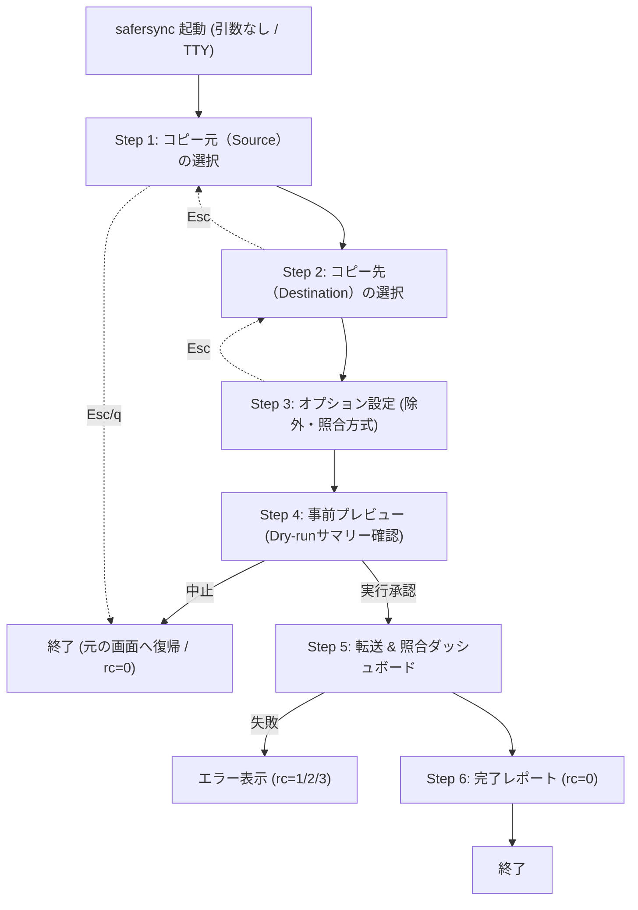

# safersync TUI（ターミナルUI）詳細設計・開発計画書

> **改訂版（v1.1.0 計画 / Rev.2）**
> 初版をコードベース（`bin/safersync` v1.0.0 / `test/safersync.bats`）と突き合わせて検証し、
> 実装時に破綻する箇所を修正した。主な修正点は次のとおり。
>
> 1. **Bash 3.2 で `read -t 0.1` は使用不可**（実測: `invalid timeout specification`）。
>    キー入力は `stty min/time` ベースへ全面差し替え（→ 5.1）。
> 2. **インストールがシンボリックリンク前提**のため、`lib/` の探索は `$0` を
>    シンボリックリンク解決してから行う必要がある（→ 4.2）。
> 3. **日本語は East Asian Width で 2 桁**として数えないと罫線が崩れる（→ 5.4）。
> 4. 既存テストは **47 項目**（初版の「30 項目」は誤り。→ 7 / Phase 1）。
> 5. 現行コードは表示とロジックが混在している。**コア分離時に「表示の分離」を明示的な
>    要件**に追加（→ 4.3）。
> 6. バージョン `1.0.0` は **本体・README・テストの3箇所**に直書きされている。
>    更新対象チェックリストを追加（→ 付録 A）。

---

## 1. 概要とコンセプト

### 1.1 背景
`safersync` は「誤削除が絶対に起きない安全性」と「転送から照合までの確実性」を備えた CLI ツールです。
しかし、以下のような課題があります。
- ボリュームパス（`/Volumes/Untitled/DCIM/100GOPRO` や `/Volumes/HDPC-UT/GoPro`）のフルパス入力が手動だと面倒
- `.LRV` や `.THM` などの除外オプション（`--exclude`）を覚えるのが大変
- ターミナルに不慣れなユーザーにとって心理的ハードルが高い

### 1.2 ゴール
**「コマンドラインに不慣れな人でも、矢印キーとスペースキーだけで、安全かつ確実にSDカードからHDDへ同期できる体験」**
ターミナルで `safersync` と打つだけで、美しいウィザード画面が起動します。

### 1.3 非ゴール（今回やらないこと）
- コピー先の余分なファイルを消す機能（**削除機能は今後も搭載しない**）
- 複数ジョブのキュー管理（1 実行 1 組のまま。複数は従来どおり回数を分けて実行）
- 設定ファイルの導入（引数 ＋ 実行時オプションのみ）
- GUI（`.app`）化

---

## 2. コア設計原則（絶対条件）

1. **追加インストール不要（Zero Third-party Dependencies）**
   - Python / Node.js / Go / Rust / Homebrew パッケージ（`dialog` `whiptail` `fzf` 等）は**一切不使用**。
   - **macOS 標準の Bash 3.2 と、macOS に元から入っている標準コマンド**
     （`rsync` `find` `awk` `xargs` `stat` `df` `mount` `stty` `tput` `mktemp` `caffeinate`）だけを使う。
   - 「依存ゼロ」の意味はここでは *追加インストールが不要* であること。`tput` 等の標準コマンドの利用は許容する
     （初版の「ANSIエスケープコードのみ」という表現は、`tput` を使う既存実装と矛盾していたため明確化）。
2. **完全な後方互換性（Backward Compatibility）**
   - 引数あり（`safersync <src> <dst>` など）では、既存の CLI モードとして**完全互換**で動作する
     （自動化スクリプトや cron を壊さない）。これは既存 47 テストが無修正で通ることを意味する。
   - `--tui` / `-i` を付ければ TUI を強制起動し、位置引数があればそのパスを初期値としてプリフィルする（任意）。
3. **TUI は「対話端末のときだけ」起動する**
   - 引数なしの呼び出しでも、`stdin` か `stdout` が TTY でなければ TUI を起動せず、
     従来どおりの使い方エラー（終了コード 1）を返す。パイプ・リダイレクト・cron でハングさせない。
4. **ターミナル画面の原状復帰（Alternate Screen）**
   - TUI 起動時は ANSI Alternate Screen（`\033[?1049h`）へ切り替え、終了・中断時に必ず元へ戻す。
   - **`stty` の元設定を `stty -g` で保存し、終了時に復元する**（初版の `stty echo icanon` は
     端末の元状態を壊しうるため不十分）。
5. **安全性の可視化（Fail-Safe UX）**
   - コピー開始前に「自動 dry-run」を実行し、転送ファイル数・サイズ・空き容量を必ずユーザーに確認させる。
   - 既存の安全装置（未マウント検出＝終了コード2、空き容量チェック＝終了コード3、削除なし）を
     TUI 経由でも**すべて素通りさせない**。
6. **終了コード契約の維持**
   - TUI 経由でも、コピー/照合の失敗は CLI と同じ終了コードを返す
     （0 成功 / 1 エラー / 2 未マウント / 3 空き容量不足 / 130 中断）。
   - ユーザーがプレビュー画面で「中止」した場合は **0**（何もしていないのでエラーではない）。

---

## 3. 画面遷移と各ステップのUI設計



> 画面番号はウィザード部分を `[n/4]` と表記し、実行フェーズ（Step 5/6）は番号なしの
> 「進行画面」として扱う（初版の番号表記の揺れを整理）。

### Step 1: コピー元（Source）の選択画面
接続されているボリュームを自動検知し、GoPro特有の `DCIM` フォルダやよく使う場所をサジェストします。

```text
┌── safersync v1.1.0 ──────────────────────────────────────────┐
│ [1/4] コピー元（転送したいデータ）を選択してください           │
├──────────────────────────────────────────────────────────────┤
│                                                              │
│  接続中のボリューム:                                         │
│    [ ] Macintosh HD          (空き 116 GB)                   │
│  > [*] Untitled (microSD)    (空き 210 GB / 使用 28 GB)       │
│    [ ] HDPC-UT (外付けHDD)   (空き 759 GB)                   │
│                                                              │
│  フォルダの候補:                                             │
│  > 1) DCIM/100GOPRO          (GoPro 撮影データ - 28 GB)      │
│    2) DCIM 全体                                              │
│    3) ボリューム直下全体                                     │
│    4) パスを手動入力する...                                  │
│                                                              │
├──────────────────────────────────────────────────────────────┤
│ [↑/↓] 移動   [Enter] 選択   [q/Ctrl-C] 終了                  │
└──────────────────────────────────────────────────────────────┘
```

- ボリューム一覧は既存 `do_status` 相当のロジック（`$MOUNT_ROOT/*` ＋ `df -h`）を再利用する。
- 候補フォルダは「存在するもの」のみ列挙（`DCIM/*` は `DCIM` 配下の実在ディレクトリを列挙）。
- サイズ表示は `scan_dir` 相当だが、**大容量ボリュームでは数秒かかる**ため、
  まず名前だけ即時表示 → サイズは非同期（サブシェル）で後追い更新する。

### Step 2: コピー先（Destination）の選択画面
保存先となる外付けHDDを選び、既存の保存先フォルダを選択または新規作成します。

```text
┌── safersync v1.1.0 ──────────────────────────────────────────┐
│ [2/4] コピー先（保存先フォルダ）を選択してください             │
├──────────────────────────────────────────────────────────────┤
│                                                              │
│  保存先ボリューム:                                           │
│  > [*] HDPC-UT (外付けHDD)   (空き 759 GB)                   │
│    [ ] Macintosh HD          (空き 116 GB)                   │
│                                                              │
│  保存先フォルダの指定:                                       │
│  > 1) GoPro                  (既存フォルダ / 172 GB 保存中)  │
│    2) Backup                                                 │
│    3) 新しいフォルダ名を指定して作成...                       │
│    4) パスを手動入力する...                                  │
│                                                              │
├──────────────────────────────────────────────────────────────┤
│ [↑/↓] 移動   [Enter] 決定   [Esc] 前の画面に戻る             │
└──────────────────────────────────────────────────────────────┘
```

- **コピー元と同じボリュームは選択不可**（誤ってSD→SDのコピーを始めない）。
- 新規フォルダ作成時の文字入力は、パスに使えない文字（`/` など）を弾くバリデータを通す。
- 「ボリューム直下を選んだ」場合は、既存 CLI と同じ警告（中身が散らばる）を Step 4 で再掲する。

### Step 3: オプション設定画面（トグル式）
スペースキーで簡単に除外設定や照合設定を切り替えられます。

```text
┌── safersync v1.1.0 ──────────────────────────────────────────┐
│ [3/4] 同期オプションを設定してください                       │
├──────────────────────────────────────────────────────────────┤
│                                                              │
│  [X] プレビュー動画 (.LRV) を除外 (容量・時間を大幅に節約)   │
│  [X] サムネイル画像 (.THM) を除外                            │
│  [ ] 一時ファイル (*.tmp, .DS_Store 等) を除外               │
│                                                              │
│  照合方法:                                                   │
│  > (*) 高速照合（サイズ + 更新日時）- 推奨                   │
│    ( ) 厳密照合（ファイル全体のチェックサムハッシュ）        │
│                                                              │
│  詳細オプション:                                             │
│    [X] スリープ防止 (caffeinate) を有効にする                │
│                                                              │
├──────────────────────────────────────────────────────────────┤
│ [↑/↓] 移動   [Space] 切り替え   [Enter] 次へ   [Esc] 戻る     │
└──────────────────────────────────────────────────────────────┘
```

- 各トグルは最終的に既存の CLI 引数へマッピングする：
  `.LRV`/`.THM`/一時ファイル → `--exclude`、厳密照合 → `--checksum`、
  スリープ防止 OFF → `--no-caffeinate`。
- `.DS_Store` 等のメタファイルは**既に `DEFAULT_EXCLUDES` で常時除外**されている。
  「一時ファイル」トグルは `*.tmp` 等の**追加**パターンであることを UI 上も明記する（重複を避ける）。
- caffeinate トグルは `command -v caffeinate` が無い環境では「利用不可」としてグレー表示。

### Step 4: 事前プレビュー（Dry-run 確認画面）
設定に基づき差分を計算し、実行前の安心感を提供します。

```text
┌── safersync v1.1.0 ──────────────────────────────────────────┐
│ [4/4] 転送内容の最終確認                                     │
├──────────────────────────────────────────────────────────────┤
│                                                              │
│  コピー元: /Volumes/Untitled/DCIM/100GOPRO                   │
│  コピー先: /Volumes/HDPC-UT/GoPro                            │
│  除外設定: *.LRV, *.THM                                      │
│                                                              │
│  差分スキャン結果:                                           │
│    ・転送対象:   2 ファイル (442.3 MB)                       │
│    ・スキップ: 118 ファイル (27.5 GB - すでに転送済み)       │
│    ・転送先空き容量: 759 GB [十分な空きがあります]           │
│                                                              │
│  同期を開始しますか？                                        │
│  > [ 今すぐ開始する ]         [ 設定を戻す ]      [ 中止 ]   │
│                                                              │
├──────────────────────────────────────────────────────────────┤
│ [←/→] 選択   [Enter] 決定   [Esc] 中止                       │
└──────────────────────────────────────────────────────────────┘
```

- 差分計算（`plan_changes` / rsync dry-run）は**サブプロセスで実行し、スピナーで進捗を表示**する。
  数万人規模のフォルダで画面が固まらないようにする。
- 空き容量不足（`free < PLAN_BYTES`）を検出したら、**実行ボタンを無効化**して
  既存の終了コード 3 と同じ条件でブロックする（`--ignore-space-check` 相当の抜け道は
  「詳細オプション」に格納し、既定では出さない）。
- コピー先が未マウント／存在しない場合の確認もこの画面で行い、`require_mounted_dest` 相当を必ず通す。

### Step 5: 転送 & 照合ダッシュボード
全体の進捗率、転送速度、残り時間、現在処理中のファイル名を描画します。

```text
┌── safersync 同期中 ──────────────────────────────────────────┐
│ コピー中: GX011025.MP4 (1/2 ファイル)                        │
│                                                              │
│   [████████████████████░░░░░░░░░░]  65%                      │
│   287.5 MB / 442.3 MB  (85.2 MB/s)  残り時間 約 2秒          │
│                                                              │
│ ステータス:                                                  │
│   [✔] 事前チェック (マウント状態・空き容量確認)              │
│   [▶] ファイル転送中...                                      │
│   [ ] コピー後データ整合性照合                               │
├──────────────────────────────────────────────────────────────┤
│ [Ctrl-C] 安全に中断（次回続きから再開可能）                  │
└──────────────────────────────────────────────────────────────┘
```

- 進捗は既存 `run_with_progress` の「**転送先の増分を `scan_dir` で測る**」方式を踏襲する。
  これは macOS 標準 rsync 2.6.9 では `--info=progress2` が使えないための**意図的な選択**であり、
  移植性を優先している。ポーリング間隔（現状 2 秒）は TUI では表示更新の滑らかさとのトレードオフで調整する。
- 現状処理中のファイル名は `rsync -v`（または `--out-format`）の出力を一時ファイル経由で読み、
  末尾 1 行を「現在のファイル」として表示する（進捗行とログが混ざらないよう分離）。
- 実行中の `trap` は **TUI 側と `run_with_progress` 側で二重定義が衝突**するため、
  TUI 起動時にコアの trap を無効化し、TUI が一元的に子プロセス（caffeinate → rsync）を停止する。

### Step 6: 完了サマリー画面
結果を一目で把握でき、安全にメディアを取り出せる状態であることを伝えます。

```text
┌── safersync 完了 ────────────────────────────────────────────┐
│ ✔ すべての処理が正常に完了しました                           │
├──────────────────────────────────────────────────────────────┤
│                                                              │
│  転送結果:                                                   │
│    ・転送完了: 2 ファイル (442.3 MB / 5秒)                   │
│    ・照合結果: 正常（すべてのファイルが一致）                │
│    ・ログ保存: ~/Library/Logs/safersync/safersync.log        │
│                                                              │
│  microSDカードを安全に取り外すことができます。               │
│                                                              │
│  > [ 終了する ]                                              │
│                                                              │
├──────────────────────────────────────────────────────────────┤
│ [Enter] 終了                                                 │
└──────────────────────────────────────────────────────────────┘
```

- 失敗時はこの画面を赤系の「エラー要約」に切り替え、`r` でログの該当行を表示、`q` で終了。
- ログの場所は既存の `LOG_FILE` をそのまま表示する（新規ログ基盤は作らない）。

---

## 4. アーキテクチャとファイル構成

### 4.1 ファイル構成

```text
safersync/
├── bin/
│   └── safersync             # エントリーポイント（引数チェック・モード分岐・lib の読み込み）
├── lib/
│   ├── core/                 # ★ 表示を持たない純ロジック（既存 CLI と TUI が共有）
│   │   ├── env.sh            # OS判定・ログ・色定義・共通ヘルパ（fmt_bytes 等）
│   │   ├── disk.sh           # ボリューム検知・空き容量・マウント判定
│   │   ├── sync.sh           # rsync 実行・差分収集・除外制御
│   │   └── verify.sh         # データ照合エンジン
│   └── tui/                  # ★ 画面（表示）だけを担当
│       ├── terminal.sh       # 画面バッファ切替・カーソル制御・stty 退避復元・trap
│       ├── input.sh          # キーコード解析（矢印キー、Enter、Space 等）
│       ├── layout.sh         # ★ 表示幅計算（East Asian Width）・罫線・パディング
│       ├── components.sh     # ボックス描画、リスト、トグルスイッチ部品
│       └── views/
│           ├── step_src.sh   # コピー元選択画面
│           ├── step_dst.sh   # コピー先選択画面
│           ├── step_opt.sh   # オプション設定画面
│           ├── step_prev.sh  # プレビュー画面
│           └── dashboard.sh  # 実行中プログレス画面
├── test/
│   ├── safersync.bats        # CLI既存テスト（47項目。無修正で通すこと）
│   ├── tui_layout.bats       # ★ 表示幅・罫線の純粋関数テスト
│   └── tui_components.bats   # TUIコンポーネントテスト
└── README.md
```

> 初版になかった `lib/tui/layout.sh` を追加（日本語幅の計算は描画の前提であり、
> 独立したテスト対象にすべき中核ロジックのため）。

### 4.2 lib の読み込みはシンボリックリンクを解決してから（重要）

README のインストール手順は

```sh
ln -sfn ~/safersync/bin/safersync ~/.local/bin/safersync
```

という**シンボリックリンク**を前提にしている。この場合 `$0` は `~/.local/bin/safersync` であり、
`dirname "$0"` からは `lib/` に到達できない。さらに macOS の `readlink -f` は
古い OS では使えない可能性があるため、`-f` に依存しない解決関数を `bin/safersync` 先頭に置く。

```bash
resolve_script_dir() {       # $1=スクリプトのパス（$0）
  local src="$1" dir
  while [ -h "$src" ]; do
    dir="$(cd -P "$(dirname "$src")" >/dev/null 2>&1 && pwd)"
    src="$(readlink "$src")"
    case "$src" in /*) ;; *) src="$dir/$src" ;; esac
  done
  cd -P "$(dirname "$src")" >/dev/null 2>&1 && pwd
}
SCRIPT_DIR="$(resolve_script_dir "$0")"
# shellcheck source=/dev/null
. "$SCRIPT_DIR/../lib/core/env.sh"
# （以降、必要なモジュールを source する）
```

### 4.3 コアは「表示しない」— 表示とロジックの分離（重要）

現行の `bin/safersync` は `info` / `ok` / `err` を**関数内から直接 stdout/stderr へ出力**している。
これをそのまま `lib/core/` に切り出すと、TUI がコアを呼ぶたびに画面が壊れる。
そこでコア分離時に次を守る。

- コア関数は**標準出力に表示用文言を出さない**。結果は終了コード＋グローバル変数
  （例: `PLAN_FILES` / `PLAN_BYTES` / `DIFF_RAW`）で返す。
- 人間向けメッセージが必要な CLI モードでは、コアの薄いラッパ（`lib/core` の外）が
  メッセージを組み立てて表示する。
- ログ（`log_msg`）は**ファイル出力なので両モードで共有してよい**。ただし TUI では
  標準エラーへ出さない。
- 進捗コールバックは、CLI は既存の `draw_progress`、TUI は `dashboard.sh` の描画関数を
  差し替えられるようにする（`PROGRESS_RENDERER` のような関数名変数で注入）。

これにより「CLI の見た目を変えずにコアだけ分離する」ことができ、既存 47 テストの回帰を防げる。

---

## 5. 技術的実装手法

### 5.1 キー入力のリアルタイム検出（Pure Bash 3.2・要修正）

> ⚠️ **初版のコードは macOS 標準 Bash 3.2 では動作しない。**
> 実測: `/bin/bash -c 'read -rsn1 -t 0.1 k'` → `read: 0.1: invalid timeout specification`。
> Bash 3.2 の `read -t` は**整数秒のみ**受け付ける（小数は Bash 4.0 以降）。

小数タイムアウトの代わりに `stty` の `min`/`time` を使う。`time` の単位は 1/10 秒。

```bash
# --- 端末モードの退避と復元 ---
TUI_STTY_SAVE=""
tui_raw_on() {
  TUI_STTY_SAVE="$(stty -g 2>/dev/null)"        # 元の設定を丸ごと保存
  stty -echo -icanon min 1 time 0 2>/dev/null   # 1文字ずつ・エコーなし
}
tui_raw_off() {
  [ -n "$TUI_STTY_SAVE" ] && stty "$TUI_STTY_SAVE" 2>/dev/null
}

# --- ESC シーケンス対応のキー読み取り ---
#   通常時は min 1（1文字来るまで待つ）。ESC の続きだけ min 0 time 1（0.1秒）で待つ。
read_key() {
  local c1 c2 c3
  IFS= read -rsn1 c1 || { printf 'EOF'; return; }

  if [ "$c1" = $'\x1b' ]; then
    stty min 0 time 1 2>/dev/null
    if ! IFS= read -rsn1 c2; then
      stty min 1 time 0 2>/dev/null
      printf 'ESC'; return
    fi
    case "$c2" in
      '['|'O')
        IFS= read -rsn1 c3 || { stty min 1 time 0 2>/dev/null; printf 'ESC'; return; }
        stty min 1 time 0 2>/dev/null
        case "$c3" in
          A) printf 'UP' ;;   B) printf 'DOWN' ;;
          C) printf 'RIGHT';; D) printf 'LEFT' ;;
          H) printf 'HOME';;  F) printf 'END'  ;;
          Z) printf 'BTAB' ;;
          *) printf 'ESC' ;;
        esac ;;
      *) stty min 1 time 0 2>/dev/null; printf 'ESC' ;;
    esac
    return
  fi

  case "$c1" in
    '')     printf 'ENTER' ;;   # Bash 3.2 では Enter は空文字になる（実測で確認）
    ' ')    printf 'SPACE' ;;
    $'\x7f'|$'\b') printf 'BACKSPACE' ;;
    q|Q)    printf 'QUIT' ;;
    j)      printf 'DOWN' ;;    # vim 風
    k)      printf 'UP' ;;      # vim 風
    *)      printf '%s' "$c1" ;;
  esac
}
```

- `read_key` の出力は「1 語」なので、呼び出し側は `case "$(read_key)" in ...` で分岐する。
- **`min 1 time 0` で待つ外周ループ**にすることで、`read_key` の空文字（Enter）と
  タイムアウトを混同しない（初版はこの区別がなく、タイムアウトを Enter と誤認する恐れがあった）。

### 5.2 チラつき防止（ダブルバッファリング的描画）
1 行ずつ `echo` すると再描画時に画面がチラつくため、画面全体を変数バッファに構築し、
**カーソルを原点へ戻して 1 回の `printf` で一括出力**する。行数が減る場合に備え、
各フレームの最後に `\033[J`（カーソル以降を消去）を付ける。

```bash
render() {
  local buf="$1"
  printf '\033[H%s\033[J' "$buf"   # ホームへ移動 → 一括描画 → 残りを消去
}
```

### 5.3 割り込み・終了時の安全な画面復元（Trap）

```bash
cleanup_tui() {
  trap - EXIT INT TERM HUP          # 二重実行を防ぐ
  tui_raw_off                       # stty を元へ戻す
  printf '\033[?25h'                # カーソル再表示
  printf '\033[?1049l'              # メインスクリーンへ復帰
  printf '%s' "$C_RESET"
}
tui_enter() {
  printf '\033[?1049h\033[?25l'     # 代替画面へ・カーソル非表示
  tui_raw_on
  trap cleanup_tui EXIT INT TERM HUP
}
```

- カーソル再表示は `tput cnorm` ではなく ANSI（`\033[?25h`）に統一し、`tput` 依存を減らす。
- `trap - ...` を先頭で外し、`INT`→`EXIT` の連鎖による二重クリーンアップを防ぐ。
- **実行中（Step 5）の Ctrl-C** は、TUI が子プロセス（`caffeinate` → `rsync`）を
  `pkill -TERM -P` → `kill` の順で停止し、`--partial` により次回再開できる状態を保つ。

### 5.4 日本語を含む文字列の表示幅（East Asian Width・重要）

罫線とパディングは「バイト数」でも「文字数」でもなく**表示桁数**で計算する必要がある。
実測: `s="日本語abc"` のとき `${#s}` は `6` だが、表示幅は `9`。
素朴に `${#s}` で右端の `│` を合わせると日本語行だけガタつく。

UTF-8 ロケール前提で、コードポイントが East Asian Wide/Fullwidth の範囲なら 2、それ以外は 1 と数える。

```bash
# 1 文字の表示幅を返す（$1=1文字）
char_width() {
  local c="$1" b o n w=1
  b="$(printf '%s' "$c" | od -An -tu1 | tr -s ' ' '\n' | grep -v '^$')"
  set -- $b
  n="$#"                         # UTF-8 のバイト数
  [ "$n" -le 1 ] && { printf 1; return; }   # ASCII は 1
  # 先頭バイトからコードポイントを概算（主要レンジのみ判定）
  local lead="$1"
  if [ "$n" = 3 ]; then
    local cp=$(( (lead - 224) * 4096 + ($2 - 128) * 64 + ($3 - 128) ))
    # CJK・かな・全角記号・ハングル・全角英数 等
    if { [ "$cp" -ge 0x1100 ] && [ "$cp" -le 0x115F ]; } \
    || { [ "$cp" -ge 0x2E80 ] && [ "$cp" -le 0xA4CF ]; } \
    || { [ "$cp" -ge 0xAC00 ] && [ "$cp" -le 0xD7A3 ]; } \
    || { [ "$cp" -ge 0xF900 ] && [ "$cp" -le 0xFAFF ]; } \
    || { [ "$cp" -ge 0xFE30 ] && [ "$cp" -le 0xFE6F ]; } \
    || { [ "$cp" -ge 0xFF00 ] && [ "$cp" -le 0xFF60 ]; } \
    || { [ "$cp" -ge 0xFFE0 ] && [ "$cp" -le 0xFFE6 ]; }; then w=2; fi
  fi
  printf '%d' "$w"
}

# 文字列の表示幅
disp_width() {
  local s="$1" total=0 i c
  for (( i=0; i<${#s}; i++ )); do
    c="${s:i:1}"
    total=$(( total + $(char_width "$c") ))
  done
  printf '%d' "$total"
}

# 幅 w になるよう半角スペースで右詰め（切り詰めは呼び出し側の方針に任せる）
wpad() {   # $1=文字列 $2=目標幅
  local s="$1" w="$2" cur pad
  cur="$(disp_width "$s")"
  pad=$(( w - cur )); [ "$pad" -gt 0 ] || pad=0
  printf '%s%*s' "$s" "$pad" ''
}
```

- **必ず UTF-8 ロケールで動かす**。`LC_ALL=C` の環境では `${#s}` がバイト数になり破綻するため、
  TUI 起動時に `LC_CTYPE` が UTF-8 でなければ警告するか、`LC_CTYPE=en_US.UTF-8` を試行する。
- 罫線・アイコン（`█` `░` `✔` `▶`）も幅 1 前提で扱う（大半は幅 1）。
- `wpad` を使い「ラベル + 表示幅で埋めた空白 + `│`」の順で組み立てれば、日本語混在でも右端が揃う。
- `char_width` は 1 文字ごとにサブシェルを起動するため、**画面バッファ構築時に毎回呼ぶと重い**。
  ASCII 判定を先に行い、非 ASCII のみ `od` を通す等の最適化を行う（4.1 で `layout.sh` を分離した理由）。

### 5.5 端末サイズ・リサイズ・最小サイズ

- 幅・高さは `COLUMNS`/`LINES` を優先し、無ければ `tput cols`/`tput lines`、無ければ 80x24。
- **最小サイズ（例 60x20）を下回ったら**、ボックスを描かず
  「ターミナルを広げてください（現在 42x15）」と 1 行で表示する（折り返し崩れを防ぐ）。
- `SIGWINCH` を trap して `WINCH=1` フラグを立て、次の描画サイクルで再レイアウトする。
  （Bash 3.2 でも `trap 'WINCH=1' WINCH` は動作する。）

### 5.6 非 TTY ガード

```bash
if [ ! -t 0 ] || [ ! -t 1 ]; then
  # TUI を起動せず、通常の usage（終了コード 1）へフォールバック
fi
```

パイプ・リダイレクト・CI・cron で TUI がハングするのを防ぐ。`--tui` を明示した場合は
「対話端末ではありません」とエラーにして終了コード 1 を返す。

---

## 6. 安全性・エラー処理（TUI でも必須）

| 状況 | CLI の挙動 | TUI での対応 |
|---|---|---|
| コピー先ボリューム未マウント | 終了コード 2 で中断 | Step 4 で事前検出し、開始ボタンを無効化（rc=2 を踏襲） |
| 空き容量不足 | 終了コード 3 で開始前中断 | Step 4 で警告し開始不可（`--ignore-space-check` は詳細オプションへ退避） |
| 転送中の Ctrl-C | 終了コード 130 | 子プロセス停止 → 画面復元 → rc=130 |
| 転送中にメディア抜去 | rsync エラー | エラー要約を表示し、ログの該当行を提示（rc=1） |
| 照合の不一致 | 終了コード 1 | Step 6 を赤系エラー要約に切替、該当ファイルを提示 |
| ターミナルが狭すぎる | 該当なし | 最小サイズ未満なら案内文のみ表示 |

- **削除は一切しない**という不変条件を、TUI のどの画面でも破らない（`--delete` 系は生成しない）。
- ログは常に既存 `LOG_FILE` に追記し、TUI 終了後も `--help` 等から確認できる状態を保つ。

---

## 7. テスト戦略

TUI は擬似端末が必要で bats だけでは回帰が取りにくい。そこで**「純粋関数」と「画面統合」を分離**する。

- **純粋関数（bats で通常テスト可能）**：`disp_width` / `wpad` / `char_width` / `fmt_bytes` /
  ボックス文字列生成（`render_box` が文字列を返す設計にする）/ `read_key` へのバイト列投入。
  - `read_key` は標準入力に `printf '\033[A'` 等を流して出力語を検証できる（`stty` を挟まない
    テスト用モードを用意する）。
- **画面統合（任意・擬似端末）**：`script`（macOS 標準）で PTY を作り、
  `safersync` 無引数 → 数キー入力 → 終了、を流してクラッシュしないことと終了コードを確認する。
- **回帰**：既存 `test/safersync.bats`（**47 項目**）は **1 件も修正せず** 通す。
  バージョン表記のテストだけは v1.1.0 へ更新が必要（→ 付録 A）。
- **静的チェック**：`shellcheck -S warning` を新規 `lib/**/*.sh` にも適用する
  （既存テストに `shellcheck` 実行があるため、`lib` を追加したら対象に含める）。

---

## 8. 実装フェーズとスケジュール

| フェーズ | テーマ | 主な作業内容 | 完了条件（受け入れ基準） |
|---|---|---|---|
| **Phase 1** | **コアロジックの分離** | 既存 `bin/safersync` からコア機能（`disk` / `sync` / `verify` / `env`）を `lib/core/` に切り出し。**表示はコアから追い出す**（4.3）。シンボリックリンク解決で lib を読み込む（4.2）。 | 既存 `test/safersync.bats` の **47 項目がすべてパス**（無修正）。`safersync`（引数あり）の出力が初版と同一 |
| **Phase 2** | **TUI コアエンジンの構築** | `terminal.sh`（Alternate Screen・stty 退避復元・trap・SIGWINCH）、`input.sh`（5.1 のキー入力）、`layout.sh`（5.4 の幅計算）、`components.sh`（枠・リスト・トグル）。 | `tui_layout.bats` / `tui_components.bats` がパス。日本語混在行で右端 `│` が揃う。Bash 3.2 でキー入力が動作（`-t 0.1` 不使用） |
| **Phase 3** | **ステップ画面の実装** | Step 1〜4 の画面とウィザード連結。非 TTY ガード、最小サイズガード、Esc 戻り。 | 実機の SD カード＋HDD で Step 1〜4 を一巡でき、Step 4 で未マウント/容量不足が正しくブロックされる |
| **Phase 4** | **ダッシュボードと連携** | Step 5（進捗・現在ファイル名・中断）、Step 6（完了/エラー要約）。コアの実行関数と直結。 | 実ファイル同期が完走し、Ctrl-C で子プロセスが確実に停止・画面復帰（rc=130）。`--partial` で再開できる |
| **Phase 5** | **ドキュメント・総合テスト・リリース** | README に TUI 章を追加、`--tui`/`-i` を usage/help に追記、バージョンを 1.1.0 へ（付録 A）、端末リサイズ・抜去などの異常系調整。 | `bats test/` 全パス ＋ `shellcheck` 警告ゼロ。`v1.1.0` タグ作成 |

依存関係: Phase 2 の `layout.sh`（幅計算）は Phase 3 の前提。Phase 4 は Phase 1 の
「表示の分離」ができている前提。Phase 1 を最優先し、CLI の回帰を最初に固定してから TUI に入る。

---

## 9. リスクと未解決事項

| # | リスク / 論点 | 対応方針 |
|---|---|---|
| R1 | Bash 3.2 の制約（小数 `read -t` 不可、`${var,,}` 不可、連想配列不可） | 5.1 / 5.4 の方針で回避。CI か手元で `/bin/bash`（3.2）実行を確認 |
| R2 | シンボリックリンク設置で `lib/` が見つからない | 4.2 の `resolve_script_dir` |
| R3 | `readlink -f` の有無（古い macOS） | `-f` を使わない解決関数 |
| R4 | 日本語幅の計算ミスで罫線が崩れる | 5.4 ＋ `tui_layout.bats` で数値検証 |
| R5 | コピー元/先のファイル名に改行・`%` が含まれる場合の表示崩れ | `printf '%s'` 徹底。改行入りファイル名は既知の制限として README に明記（コアの `plan_changes` も同様） |
| R6 | 大容量ディレクトリで Step 1/4 のスキャンが固まる | サブプロセス＋スピナー。まず一覧を即時表示しサイズは後追い |
| R7 | TUI の `trap` と既存 `run_with_progress` の `trap` 衝突 | Step 5 では TUI が一元管理（3 章 Step 5 の注記） |
| R8 | macOS 標準 rsync 2.6.9 で `--info=progress2` 不可 | 既存の転送先スキャン方式を継続（3 章 Step 5） |
| R9 | テスト自動化の難しさ | 7 章の「純粋関数 + 任意 PTY」方針 |
| R10 | `-i` ショートオプションの将来衝突 | 現時点で未使用を確認済み。予約としてドキュメント化 |

---

## 付録 A: バージョン表記の更新対象チェックリスト

`VERSION` を `1.0.0` → `1.1.0` に上げる際、次の 3 箇所（＋任意で README の例示出力）を同時に更新する。

- [ ] `bin/safersync` … `VERSION="1.1.0"`
- [ ] `test/safersync.bats` … `@test "--version は v1.1.0 を表示する"` と
      `[ "$output" = "safersync v1.1.0" ]`（現状 v1.0.0 を期待）
- [ ] `README.md` … 「`safersync v1.0.0` と表示されれば完了です」の箇所

## 付録 B: CLI オプション対応表（TUI → コア）

| TUI の操作 | 生成されるコア設定 / 引数 |
|---|---|
| `.LRV` を除外 | `--exclude '*.LRV'` |
| `.THM` を除外 | `--exclude '*.THM'` |
| 一時ファイルを除外 | `--exclude '*.tmp'` ほか（`DEFAULT_EXCLUDES` とは別枠） |
| 厳密照合を選ぶ | `CHECKSUM=1`（`--checksum`） |
| スリープ防止 OFF | `NO_CAFFEINATE=1`（`--no-caffeinate`） |
| 「今すぐ開始」 | `DRY_RUN=0` / `DO_VERIFY=1` で `run_job "$src" "$dst"` |
| Step 4 のプレビュー | `DRY_RUN=1`（`plan_changes` / `collect_diff` の結果を表示） |
